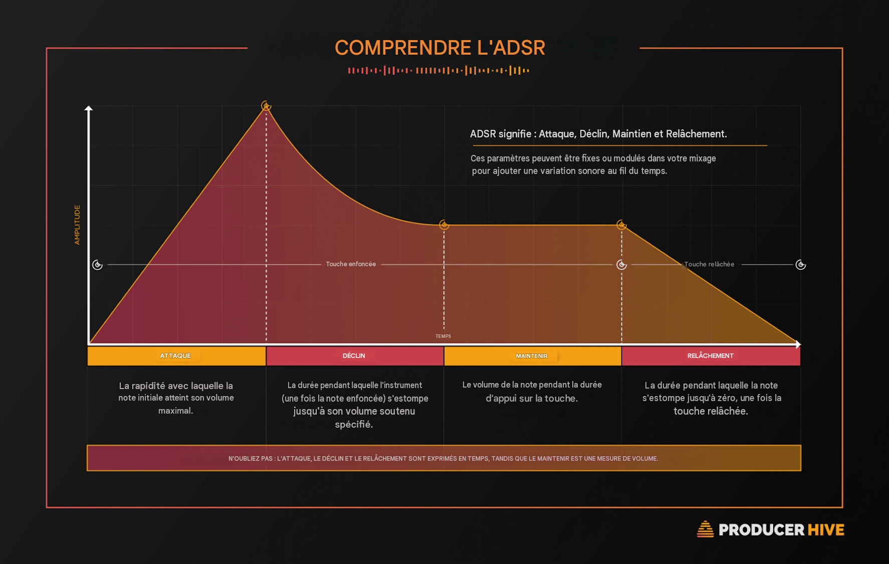

# Analyse sonore / introduction au montage audio

{data-zoom-image}<small>Source: medium.com</small>


## L'enregistrement en studio

L'objectif de l'enregistrement en studio est de réaliser une prise de son de qualité en portant une attention particulière au choix du microphone, à son positionnement, aux niveaux d'enregistrement et à l'absence de bruits parasites.

### Évaluer une prise de son

- Mon enregistrement est-il clair et facile à comprendre ?
- Les niveaux sonores sont-ils adéquats ?
- Y a-t-il des bruits parasites ou des défauts techniques ?
- Le microphone est-il bien positionné ?
- Le son capté correspond-il à mon intention de départ ?
- Ai-je choisi le bon microphone pour cette source sonore ?
- L'enregistrement met-il en valeur les caractéristiques du son ?
- La qualité obtenue est-elle suffisante pour une diffusion ou un projet créatif ?
- Que pourrais-je améliorer lors d'une prochaine prise de son ?


## Dessiner un son

{data-zoom-image}

<small>Source: www.ateliersmedicis.fr</small>
  

Il est possible de représenter un son graphiquement.

Cette méthode permet de réfléchir à sa structure et à son évolution.

### Son court

```
|
```

### Son progressif

```
/^^^^^^\
```

### Son impulsif

```
/\_
```


## Exercice de prise de son sur le terrain

<div class="grid grid-1-2" markdown>
  

  <small>Exercice de dessin</small><br>
  **[Cette activité prépare à comprendre l'enveloppe sonore.](https://www.youtube.com/watch?v=5Vb8NL3lNTs){.stretched-link .back}**

</div>


## L'enveloppe d'un son

{data-zoom-image}<small>Source: producerhive.com</small>

### Enveloppe ADSR 

| <span style="color:#b58664;">Attaque (Attack)</span> | <span style="color:#b58664;">Decay (Déclin)</span>| <span style="color:#b58664;">Maintien (Sustain)</span> | <span style="color:#b58664;">Relâchement (Release)</span> |
|------------------|------------------------|----------------------|-------------------------|
| Début du son. | Baisse du niveau après l’attaque jusqu’au sustain. | Partie stable du son. | Disparition progressive du son. |


## Pourquoi est-ce important ?

L'enveloppe permet de :

- Identifier un son
- Comprendre son comportement
- Modifier un son lors du montage

## Vocabulaire de base du son

### <span style="color:#b58664;">Paramètres du son</span>

| Paramètre | Types | Description | 
|------------|------|-------------|
| **Hauteur (pitch)** | Grave / Aigu | Détermine si un son est bas ou élevé | 
| **Intensité** | Faible / Fort | Correspond au volume sonore |
| **Dynamique** | — | Variation du volume dans le temps | 
| **Durée** | Court / Long | Temps pendant lequel le son est entendu | 
| **Distance perçue** | Proche / Lointain | Impression de proximité du son |
| **Origine du son** | Naturel / Artificiel | Source du son | 


### <span style="color:#b58664;">Morphologie temporelle du son</span>

| Paramètre | Types | Description | 
|------------|------|-------------|
| **Attaque** | Franche / Progressive | Manière dont le son commence | 
| **Chute / extinction** | Franche / Progressive | Manière dont le son se termine | 
| **Continuité** | Continu / Discontinu | Organisation du son dans le temps | 
| **Évolution du son** | Constant / Fluctuant | Variation globale du son dans le temps | 
| **Mouvement** | Ascendant / Descendant | Direction de variation du son | 


## Timbre et caractère sonore

Le timbre est ce qui permet de reconnaître un son même s’il a la même note ou le même volume qu’un autre.

### <span style="color:#b58664;">Qualités du timbre</span>

| Qualité | Description | 
|----------|-------------|
| **Sec / Résonant** | Sensation d’espace autour du son |
| **Mat / Brillant** | Présence des hautes fréquences | 
| **Riche** | Complexité harmonique - Beaucoup de fréquences simultanées |
| **Nasal** | Concentration des médiums |
| **Chaud** | Dominance des basses et médiums<br>Son agréable, rond |
| **Rond** | Son doux, sans agressivité, bien équilibré |
| **Métallique** | Présence de résonances aiguës | 
| **Strident** | Très aigu, agressif, parfois désagréable ou perçant |


## Projet A – Banque de sons et rêve sonore (30%)

<div class="grid grid-1-2" markdown>
  

  <small>Banque de sons et rêve sonore</small><br>
  **[Projet A](./examens/projet-a.md){.stretched-link .back}**
</div>


## Introduction à Reaper

{data-zoom-image}<small>Source: reaper.fm</small>

## Qu'est-ce que Reaper ?

**Reaper** est une station audionumérique (DAW) permettant de :

- Enregistrer
- Monter
- Mixer
- Produire du contenu sonore


## Fonctions importantes

- Importer des fichiers
- Déplacer des éléments
- Couper des sections
- Ajuster le volume
- Utiliser la table de mixage

<div class="grid grid-1-2" markdown>
  

  <small>REAPER</small><br>
  **[Gestion de projet dans Reaper](./exercices/reaper1.md){.stretched-link .back}**
</div>

<div class="grid grid-1-2" markdown>
  

  <small>REAPER</small><br>
  **[Importation et organisation dans Reaper](./exercices/reaper2.md){.stretched-link .back}**
</div>

<div class="grid grid-1-2" markdown>
  

  <small>REAPER</small><br>
  **[Enregistrement dans Reaper](./exercices/reaper3.md){.stretched-link .back}**
</div>

<div class="grid grid-1-2" markdown>
  

  <small>REAPER</small><br>
  **[Édition audio dans Reaper](./exercices/reaper4.md){.stretched-link .back}**
</div>

<div class="grid grid-1-2" markdown>
  

  <small>REAPER</small><br>
  **[Navigation](./exercices/reaper5.md){.stretched-link .back}**
</div>

<div class="grid grid-1-2" markdown>
  

  <small>REAPER</small><br>
  **[Mixage de base dans Reaper](./exercices/reaper6.md){.stretched-link .back}**
</div>

<div class="grid grid-1-2" markdown>
  

  <small>REAPER</small><br>
  **[Effets audio dans Reaper (FX)](./exercices/reaper7.md){.stretched-link .back}**
</div>


<div class="grid grid-1-2" markdown>
  

  <small>REAPER</small><br>
  **[Automatisation dans Reaper](./exercices/reaper8.md){.stretched-link .back}**
</div>

<div class="grid grid-1-2" markdown>
  

  <small>REAPER</small><br>
  **[Routage de base dans Reaper](./exercices/reaper9.md){.stretched-link .back}**
</div>

<div class="grid grid-1-2" markdown>
  

  <small>REAPER</small><br>
  **[Exportation dans Reaper](./exercices/reaper10.md){.stretched-link .back}**
</div>


## Exercices

<div class="grid grid-1-2" markdown>
  

  <small>REAPER</small><br>
  **[Initiation à Reaper](./exercices/reaper-exe.md){.stretched-link .back}**
</div>
