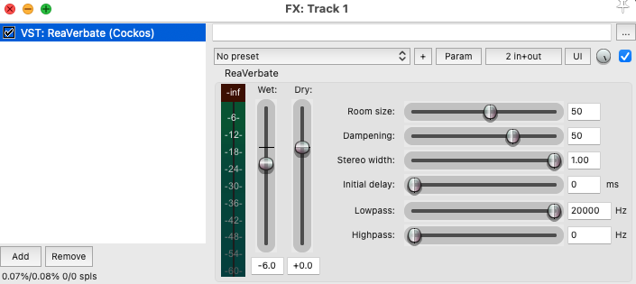

## ReaVerbate — Réverbération algorithmique

{data-zoom-image}<small>Source: reddit.com</small>

## 1. Introduction

ReaVerbate est un plugin intégré à REAPER qui permet d'ajouter une **réverbération algorithmique** à un son.

Contrairement à ReaVerb, qui utilise des **réponses impulsionnelles (IR)**, ReaVerbate génère la réverbération à partir de paramètres permettant de contrôler directement les caractéristiques de l'espace.

Il peut être utilisé pour :

- simuler une pièce
- ajouter de la profondeur
- créer une ambiance
- donner une impression d'espace
- créer des effets de sound design


## 2. Ajouter ReaVerbate à une piste

Ouvrir REAPER.

Sur la piste audio, cliquer sur le bouton **FX**.

Dans la liste des plugins, chercher :

`ReaVerbate`

Double-cliquer sur ReaVerbate pour l'ajouter à la chaîne d'effets.


## 3. Ajuster la taille de l'espace

Le paramètre **Room Size** permet de contrôler la taille virtuelle de l'espace.

Une petite valeur donne l'impression d'être dans :

- une petite pièce
- une cabine
- un studio

Une valeur plus élevée peut donner l'impression d'être dans :

- une grande salle
- un auditorium
- une église
- un espace très vaste

> Plus l'espace est grand, plus la réverbération peut sembler longue et diffuse.


## 4. Contrôler la durée de la réverbération

Le paramètre **Dampening** permet de contrôler la façon dont les hautes fréquences sont absorbées dans l'espace.

Une réverbération avec beaucoup d'absorption peut sembler :

- plus douce
- plus sombre
- plus naturelle

Une réverbération avec moins d'absorption peut sembler :

- plus brillante
- plus présente
- plus artificielle

Ce paramètre est particulièrement utile pour adapter la réverbération au type d'environnement recherché.


## 5. Ajuster le Wet et le Dry

ReaVerbate permet de contrôler la quantité de son original et de son réverbéré.

**Dry** = son original

**Wet** = son traité avec la réverbération

Pour une utilisation naturelle :

- conserver une bonne quantité de Dry
- utiliser une quantité modérée de Wet

Pour un effet créatif :

- augmenter le Wet
- réduire le Dry

Par exemple :

```text
Dry = 80 %
Wet = 20 %
```

peut produire une réverbération relativement subtile.


## 6. Pre-delay (Initial Delay)

Le **Pre-delay** permet de créer un délai entre le son original et le début de la réverbération.

Par exemple :

- **0 ms** → réverbération immédiate
- **10–30 ms** → démarre seulement après 10-30 ms
- **30–60 ms** → démarre seulement après 30-60 ms

Le Pre-delay peut permettre de conserver la clarté du son original tout en ajoutant de la profondeur.


## 7. Effets créatifs

ReaVerbate peut également être utilisé pour le **sound design**.

- 👻 Voix fantomatique
- 🏛️ Voix dans une cathédrale
- 🕳️ Voix dans une grotte
- 🚇 Voix dans un tunnel
- 📞 Voix de souvenir ou de rêve
- 🤖 Voix d'intelligence artificielle
- 👑 Voix de dieu ou de narrateur épique
- 🌌 Voix dans l'espace
- 📻 Voix provenant d'un haut-parleur lointain
- 😴 Voix dans un rêve


## 8. Utiliser ReaVerbate avec un bus

Une technique très utilisée consiste à créer une **piste de réverbération auxiliaire**.

Créer une nouvelle piste.

- Ajouter ReaVerbate sur cette piste.
- Envoyer ensuite plusieurs pistes vers cette piste de réverbération.


Cette technique permet à plusieurs sons de partager le même espace acoustique.


## 9. Automation des paramètres (ReaVerbate)

L'automation permet de faire varier automatiquement les paramètres d'un effet au cours du temps. Avec ReaVerbate, on peut par exemple faire évoluer la réverbération.

1. Comment créer une automation
1. Ajouter ReaVerbate sur une piste.
1.Cliquer sur le bouton Trim de la piste.
1. Sélectionner le paramètre à automatiser.
1. Cocher Visible et Armée pour l'automation.
1. Ajouter des points sur l'enveloppe.
1. Déplacer les points pour faire varier le paramètre dans le temps.

---

!!! Tip "Conseils pratiques"

 Éviter d'utiliser trop de réverbération lorsque le son doit rester clair.

 Une réverbération excessive peut rendre un son :

 - brouillon
 - distant
 - peu intelligible
 - difficile à mixer

 Commencer avec une petite quantité de Wet et augmenter progressivement.

---

## 10. ReaVerbate vs ReaVerb

Les deux plugins permettent de créer de la réverbération, mais leur fonctionnement est différent.

| ReaVerbate | ReaVerb |
|---|---|
| Réverbération algorithmique | Réverbération par convolution |
| Génère la réverbération | Utilise une IR |
| Paramètres d'espace directement contrôlables | Caractéristiques basées sur l'IR |
| Simple et rapide à configurer | Plus flexible avec différentes IR |
| Idéal pour expérimenter rapidement | Idéal pour reproduire des espaces précis |


---

## ReaPitch dans REAPER

{data-zoom-image}<small>Source: researchgate.com</small>

## 1. ReaPitch
**ReaPitch** est un plugin intégré à REAPER qui permet de modifier la hauteur (pitch) d’un son, de créer des harmonies, ou encore des effets de transformation vocale et sonore.


## 2. Ajouter ReaPitch à une piste
1. Ouvrir REAPER.
2. Sur la piste audio, cliquer sur le bouton **FX**.
3. Dans la liste des plugins, chercher **ReaPitch**.
4. Double-cliquer pour l’ajouter à la chaîne d’effets.


## 3. Modifier la hauteur d’un son

- Dans ReaPitch, repérer la section **Shift** ou **Pitch Shift**.
- Ajuster la valeur en **semitones (demi-tons)** :
  - +12 = une octave plus aiguë
  - -12 = une octave plus grave
- Utiliser de petites valeurs (+/- 1 à 5) pour des ajustements naturels.


## 4. Utiliser le mode formant

- Activer **Formant shift** pour préserver ou transformer le timbre.
- Utile pour :

  - éviter l’effet “chipmunk”
  - créer des voix plus naturelles ou très artificielles


## 5. Effets créatifs

ReaPitch peut être utilisé pour :

- Voix robotisées
- Effets de chute ou montée extrême (pitch automation)


## 6. Automation des paramètres (ReaPitch)
L'automation permet de faire varier automatiquement les paramètres d'un effet au cours du temps. Avec ReaPitch, on peut modifier la hauteur d'un son.

- Ajouter ReaPitch sur une piste.
- Cliquer sur le bouton Trim de la piste.
- Sélectionner le paramètre à automatiser.
- Cocher Visible et Armée pour l'automation.
- Ajouter des points sur l'enveloppe.
- Déplacer les points pour faire varier le paramètre dans le temps.
  
---

!!! Tip "Conseils pratiques"

 - Combiner ReaPitch avec reverb ou delay pour des effets plus larges.

---

## Les Motifs

<div class="grid grid-1-2" markdown>
  

  <small>Motif</small><br>
  **[Balancement](./exercices/balancement.md){.stretched-link .back}**
</div>

<div class="grid grid-1-2" markdown>
  

  <small>Motif</small><br>
  **[Miroir](./exercices/miroir.md){.stretched-link .back}**
</div>

<div class="grid grid-1-2" markdown>
  

  <small>Motif</small><br>
  **[Spirale](./exercices/spirale.md){.stretched-link .back}**
</div>

<div class="grid grid-1-2" markdown>
  

  <small>Motif</small><br>
  **[Time Stretch](./exercices/etirement-temporel.md){.stretched-link .back}**
</div>

<div class="grid grid-1-2" markdown>
  

  <small>Motif</small><br>
  **[Rebondissement](./exercices/rebondissement.md){.stretched-link .back}**
</div>

<div class="grid grid-1-2" markdown>
  

  <small>Motif</small><br>
  **[Ping-Pong](./exercices/ping-pong.md){.stretched-link .back}**
</div>

<div class="grid grid-1-2" markdown>
  

  <small>Motif</small><br>
  **[Flexion](./exercices/flexion.md){.stretched-link .back}**
</div>

<div class="grid grid-1-2" markdown>
  

  <small>Motif</small><br>
  **[Inversion](./exercices/inversion.md){.stretched-link .back}**
</div>

<div class="grid grid-1-2" markdown>
  

  <small>Motif</small><br>
  **[VITESSE DE LECTURE](./exercices/vitesse.md){.stretched-link .back}**
</div>

<div class="grid grid-1-2" markdown>
  

  <small>Motif</small><br>
  **[Percussion et Résonnance](./exercices/percussion-resonnance.md){.stretched-link .back}**
</div>


## Projet B – Continuer la réduction d’entrevue

<div class="grid grid-1-2" markdown>
  

  <small>Réduction d’entrevue</small><br>
  **[Projet B](./examens/projet-b.md){.stretched-link .back}**
</div>
